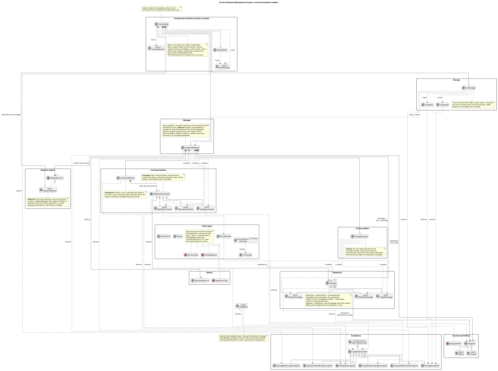

# Courier Shipment Management System

A C++20 console application that automates the logistics of a courier company:
accepting shipments, calculating shipping costs, tracking status, and keeping
a history of logistics operations.

## Requirements

- CMake 3.25 or newer
- A C++20 compiler (developed with MSVC from Visual Studio 2022; also built with GCC and Clang)

## Build, test and run

The build settings are shared in `CMakePresets.json`. VS Code's CMake Tools extension
lists the presets; from a terminal:

```sh
cmake --preset msvc            # configure (Windows, Visual Studio 2022)
cmake --build --preset msvc    # build
ctest --preset msvc            # run the tests
./build/msvc/Debug/courier     # run the application
```

On Linux use the `gcc` or `clang` preset instead (the program is then `./build/gcc/courier`).
The `gcc-asan` preset builds with AddressSanitizer and UndefinedBehaviorSanitizer, which
stop the program at the first memory error or undefined behaviour.

## Using the program

The program shows a numbered menu; type a number and press Enter.

- **Shipments:** accept a new shipment (the cost is calculated and the waybill printed), find
  one by tracking ID (e.g. `CR00000001`, any letter case), list all shipments by ID or by cost,
  report the undelivered ones, and filter by service, status, destination or cost.
- **Delivery:** dispatch the next waiting shipment (express ones go first) or change a
  shipment's status (Accepted, In transit, Delivered; one step forward at a time). Status
  changes of express and fragile shipments are reported by the dispatch module.
- **Changes:** reroute a shipment, modify its weight, size or declared value, assign it to a
  courier or office or remove the assignment. Each of these can be undone and redone.
- **Couriers and offices:** register them by a short code such as `C-01` and list them with
  the shipments assigned to them.
- **History:** every operation with its local time, and the operations that were undone.

When a prompt shows a value in brackets, such as `[0.00]`, pressing Enter keeps that value.
Where there is none, an empty line cancels the action and returns to the menu. Invalid input
is explained and changes nothing. Ctrl+Z then Enter (Windows) or Ctrl+D (Linux) ends the
program like choosing 0.

Everything is saved after each change to three CSV files in the `data` folder of the current
working directory (`assignees.csv`, `shipments.csv`, `history.csv`) and loaded again at the
next start. If the files are damaged, the program says what is wrong and asks before starting
with no data. The undo and redo lists last only while the program runs.

## Architecture



The full class diagram with every member is [docs/uml/class-diagram.png](docs/uml/class-diagram.png)
(source: [docs/uml/class-diagram.puml](docs/uml/class-diagram.puml)).

The code is split into three CMake targets:

- `courier_core`: the logic (shipments, cost calculation, manager, patterns, couriers and
  offices, CSV storage). It has no console input or output.
- `courier_console`: the console user interface (menu, input reading and parsing, formatting).
  Every class in it works on any `std::istream`/`std::ostream`, so the tests drive whole sessions.
- `courier`: the program, a small `main` that runs the console application.

### Design patterns

| Pattern | Classes | Used for |
|---------|---------|----------|
| Factory | `PackageFactory` | creating a `StandardPackage`, `ExpressPackage` or `FragilePackage` by `ServiceType`, with the next unique tracking ID, returned as `std::unique_ptr<Package>` |
| Observer | `StatusObserver` (interface), `DispatchModule`, `LogisticsManager` (subject) | notifying the dispatch module when an express or fragile shipment changes status |
| Command | `ShipmentCommand`, `RerouteCommand`, `ModifyCommand`, `AssignCommand`, `CommandHistory` | undo and redo of rerouting, modifying and assigning shipments |

### Requirements

| Requirement | Where | Tests |
|-------------|-------|-------|
| Accept shipments with a unique tracking ID | `TrackingId`, `PackageFactory`, `LogisticsManager::accept` | `TrackingIdTests`, `PackageFactoryTests`, `LogisticsManagerTests` |
| Cost from weight, volume, insurance and service type | `Package::totalCost`, `deliveryFee`/`insuranceFee` in the subclasses | `PackageTests`, `StandardPackageTests`, `ExpressPackageTests`, `FragilePackageTests` |
| Status changes (accepted, in transit, delivered) | `PackageStatus`, `canTransition`, `LogisticsManager::changeStatus` | `PackageStatusTests`, `LogisticsManagerTests` |
| Search by tracking ID (`std::unordered_map`) | `LogisticsManager::get` | `LogisticsManagerTests` |
| Report of undelivered shipments | `LogisticsManager::undelivered` | `LogisticsManagerTests` |
| Delivery queue (`std::queue`) | `LogisticsManager::dispatchNext` (express queue first) | `LogisticsManagerTests` |
| History of operations and of cancelled operations | `OperationRecord`, `LogisticsManager::history`, `cancelledOperations` | `OperationRecordTests`, `LogisticsManagerTests` |
| Assignment to couriers or offices | `Assignee`, `Courier`, `Office`, `LogisticsManager::assign` | `CourierTests`, `OfficeTests`, `AssignCommandTests` |
| Polymorphic hierarchy with a virtual destructor | `Package` and its three subclasses | `PackageTests` |
| Lambdas for filtering, sorting and processing | `LogisticsManager::filter`, `undelivered`, `assignees`; the menu table in `ConsoleApp` | `LogisticsManagerTests`, `ConsoleAppTests` |
| Smart pointers for polymorphic objects | `std::unique_ptr<Package>`, `<Assignee>`, `<ShipmentCommand>` | `PackageFactoryTests`, `LogisticsManagerTests` |
| Custom exceptions, caught | `LogisticsException` and six subclasses; caught in `ConsoleApp` | one test file per exception, `ConsoleAppTests` |
| Validation of weight and dimensions | `Dimensions`, `Package` (limits and NaN rejected) | `DimensionsTests`, `PackageTests` |
| `operator<<` waybill | `operator<<(std::ostream&, const Package&)` | `PackageTests` |
| History saved in CSV files | `CsvStorage`, `CsvWriter`, `CsvReader` | `CsvStorageTests`, `CsvWriterTests`, `CsvReaderTests` |
| UML class diagram | `docs/uml/` | |

Every class has private data members, public access functions where outside code needs the
state, and at least two constructors. The abstract bases `StatusObserver`, `ShipmentCommand`
and `Assignee` have one constructor of their own plus protected copy and move constructors
(protected so that an object cannot be sliced by copying it through a base class).
Value types such as `TrackingId`, `Money` and `OperationRecord` have no setters on purpose:
they cannot change after construction, so they cannot become invalid.

## Project layout

| Folder             | Contents                                                             |
|--------------------|----------------------------------------------------------------------|
| `include/courier/` | Public headers of the `courier_core` and `courier_console` libraries |
| `src/`             | Library sources and the console entry point (`main.cpp`)             |
| `tests/`           | Catch2 unit tests, one file per class                                |
| `docs/`            | Assignment text                                                      |
| `docs/uml/`        | UML class diagram: PlantUML sources and rendered images              |

## Updating the class diagram

The diagram is written in [PlantUML](https://plantuml.com) (needs Java). After editing a
`.puml` file, render both images again:

```sh
java -DPLANTUML_LIMIT_SIZE=16384 -jar plantuml.jar docs/uml/*.puml
```

The size limit is raised because the full diagram is larger than PlantUML's default of 4096
pixels. The images were made with PlantUML 1.2026.8.
